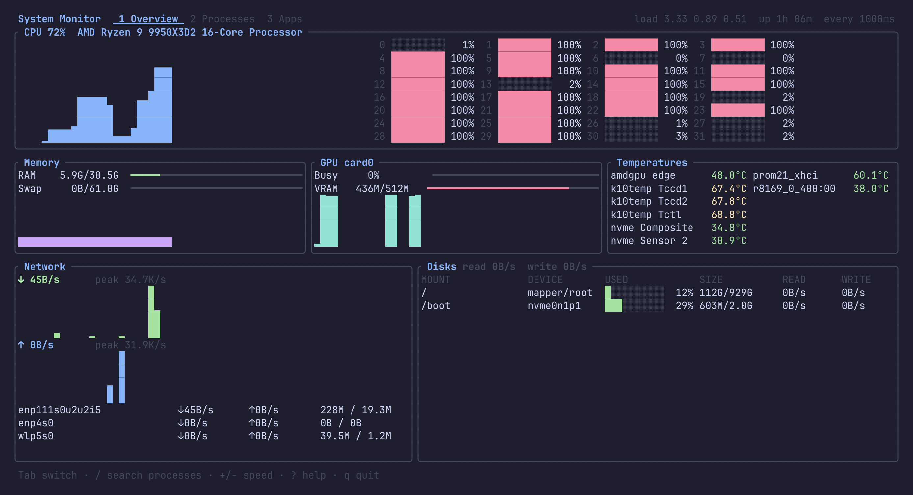

# System Monitor

A terminal task manager for [Omarchy](https://omarchy.org). It shows running processes, open Hyprland apps and live system metrics, and lets you stop any process or app from the keyboard. Colors follow the active Omarchy theme and update live when you switch themes.



## What it shows

- **Overview**: total CPU history and a bar for each core, RAM and swap, AMD GPU busy % and VRAM, temperature sensors, network throughput for each interface, and disk usage plus read/write rates.
- **Processes**: a sortable, filterable process table with an optional tree view.
- **Apps**: Hyprland windows grouped by app, with the combined CPU and memory of every process each app owns.

## Install

### From the AUR (coming soon)

The package isn't on the AUR yet; [`pkgbuild/AUR.md`](pkgbuild/AUR.md) tracks the upload. Once it's there, open the Omarchy menu → **Install → AUR** and search for `omarchy-system-monitor`, or run:

```sh
yay -S omarchy-system-monitor
```

Then open **System Monitor** from the app launcher (Super+Space), or run `omarchy-system-monitor` in a terminal. Until then, use the prebuilt binary or build from source.

### Prebuilt binary

Every [release](https://github.com/Karnav7/system-monitor/releases) has binaries for x86_64 and aarch64:

```sh
tar -xzf omarchy-system-monitor-*-x86_64-linux.tar.gz
install -Dm755 omarchy-system-monitor-*/omarchy-system-monitor ~/.local/bin/omarchy-system-monitor
```

### From source

```sh
omarchy-pkg-add rust                            # once, if cargo isn't installed
cargo install --path . --root ~/.local          # puts omarchy-system-monitor in ~/.local/bin
```

## Keys

| Key | Action |
| --- | --- |
| `Tab` / `Shift+Tab`, `1` `2` `3` | switch tab |
| `j` `k` / `↓` `↑`, `PgDn` `PgUp`, `g` `G` | move the selection |
| `/` | filter processes by name, command, user or PID (`Enter` keeps it, `Esc` clears it) |
| `s` / `r` | cycle the sort column (cpu, mem, pid, name) / reverse it |
| `t` | toggle the process tree |
| `x` / `Del` | stop the process with SIGTERM; in Apps, close the app's windows the way Super+W does |
| `X` | force kill with SIGKILL; in Apps, kill every process the app owns |
| `+` / `-` | refresh faster / slower (250 ms to 5 s) |
| `?` | show every key |
| `q` / `Ctrl+C` | quit |

Every stop or kill asks for confirmation first. System Monitor won't signal PID 1 or itself, and it warns you when the target is one of its own parent processes, such as the terminal it runs in. Processes owned by other users need `sudo omarchy-system-monitor`; otherwise you get a permission error in the status line.

## Requirements

- Linux. The Apps tab needs Hyprland; without it, the other tabs still work.
- The GPU panel reads AMD GPUs through the amdgpu driver. Other GPUs show "No amdgpu device".
- Theme colors come from `~/.local/state/omarchy/current/theme/colors.toml`. Without Omarchy, default colors are used.

## Development

```sh
cargo test
cargo clippy --all-targets -- -D warnings
cargo run
```

Releases are built by GitHub Actions when a `v*` tag is pushed. The AUR recipe lives in [`pkgbuild/`](pkgbuild/); [`pkgbuild/AUR.md`](pkgbuild/AUR.md) covers publishing it and updating it for new releases.

## License

[MIT](LICENSE)
